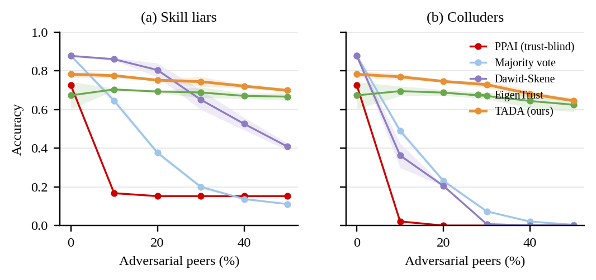
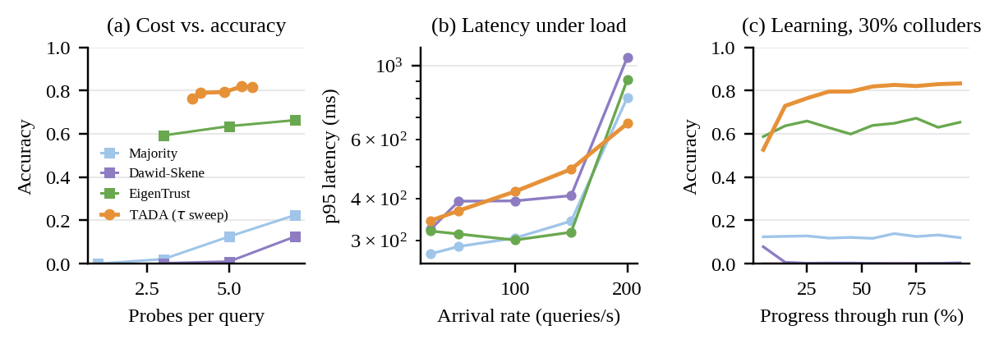

# Task III — Whom to Trust? Trust-Aware Delegation for Decentralized LLM-Agent Networks

**Group 21 · CSC 8220 · Adele Chinda, Trilok Padhi**
Follow-up to *PPAI: Enabling Personalized LLM Agent Interoperability for Collaborative Edge Intelligence* (IEEE INFOCOM 2026).

## Problem

PPAI routes each query to the peer whose agent *reports* the best capability
(and has the least load). It assumes every peer is honest. In an open edge
network a peer can lie about its skill, return wrong answers, collude with
other peers on the same wrong answer, or re-join under a fresh identity
(whitewashing) once its reputation is ruined.

**Question.** Among the peers that claim they can answer, whom should a user
trust, and how many should it ask, without a trusted third party, without
pre-trusted peers, and without paying too much in probes and latency?

## Our method: TADA (Trust-Aware Delegation with Audits)

1. **Shortlist** by reported relevance (PPAI's scoring stage, unchanged).
2. **Rank** by *estimated* accuracy per (peer, skill cluster) minus a load
   penalty. Reported skill is a filter, never a score.
3. **Sequential verification.** Ask 3 peers; if the one-coin posterior of the
   best answer is below τ, ask 2 more.
4. **Audit-capped trust.** Two Beta reputations per peer and cluster: soft
   evidence from agreement, hard evidence from gold questions (PPAI's own
   per-prototype question sets). The estimate is the agreement mean capped by
   the audit upper confidence bound: agreement can never claim more than the
   audit record supports.
5. **Anchored agreement.** Learn from agreement only when the answer still wins
   with every peer weighted by its audit-only (pessimistic) accuracy. Unaudited
   peers count as chance, so a coalition cannot bootstrap its own trust.
6. **Learned escalation (preliminary).** A Q-learning controller replaces the
   fixed τ: state = (confidence, round, load, cluster), reward = correct −
   probe cost − latency cost; trained in simulation.

## Results (5 seeds, 50 peers, 5000 queries, λ = 50/s)

| Method | No attack | 30% liars | 30% colluders | + whitewash | + camouflage | Probes | p95 (ms) |
|---|---|---|---|---|---|---|---|
| **TADA (ours)** | 0.81 | **0.79** | **0.77** | **0.75** | **0.76** | 4.2 | 376 |
| EigenTrust (m=5) | 0.68 | 0.67 | 0.64 | 0.67 | 0.66 | 5.0 | 301 |
| Dawid–Skene (m=5) | **0.87** | 0.77 | 0.01 | 0.01 | 0.34 | 5.0 | 333 |
| Majority vote (m=5) | **0.87** | 0.26 | 0.13 | 0.13 | 0.31 | 5.0 | 268 |
| PPAI (trust-blind) | 0.73 | 0.15 | 0.00 | – | – | 1.0 | – |

Full ablation in `results/ablation_table.md`. Highlights:

- Without audits TADA falls to 0.42 under collusion; without anchoring, to 0.63
  (0.47 with whitewashing).
- At 200 queries/s TADA has the lowest p95 latency (672 ms vs 804–1062 ms),
  because it sends fewer probes.
- The learned controller halves p95 latency at 150 queries/s (310 vs 576 ms)
  for −1.4 accuracy points, but does not beat the threshold rule at the
  high-accuracy end yet.
- The price of skepticism: with no attackers, TADA is 6 points below a full
  5-peer vote.




## Code

| Path | Role |
|---|---|
| `tad/profiles.py` | 5 agent types × 5 clusters, accuracies from PPAI Table I; 4-option answers with a shared distractor |
| `tad/peers.py` | honest peers and adversaries: skill liar, random, colluder, free rider; camouflage |
| `tad/simulator.py` | discrete-event simulator: Poisson arrivals, FIFO peer queues, network delay, whitewashing, churn |
| `tad/trust.py` | trust providers: none, agreement Beta, Dawid–Skene (EM), EigenTrust, TADA's audited Beta |
| `tad/routing.py` | policies as processes: PPAI argmax, fixed committees, TADA (threshold or Q-learning) |
| `experiments/run_all.py` | every experiment, figure and table in the report |
| `tests/test_tad.py` | sanity tests |

```bash
cd task3
pip install -r requirements.txt
python -m pytest -q
python -m experiments.run_all        # ~1.5 min on 32 cores; writes results/
```

## Next steps

- Replace the synthetic answer model with real per-question answers of the five
  models (run them with vLLM on MMLU / GSM8K / MedQA / ARC-C / AGIEval), so
  error correlations are real.
- Real arrival traces (Azure LLM inference, BurstGPT).
- Better learned control: credit assignment per round, contextual bandit for
  whom to audit, adaptive audit rate.
- Stronger adversaries: colluders that detect gold questions; Sybil swarms.
- Final report (IEEE, ≥ 6 pages) and 25-minute talk.
